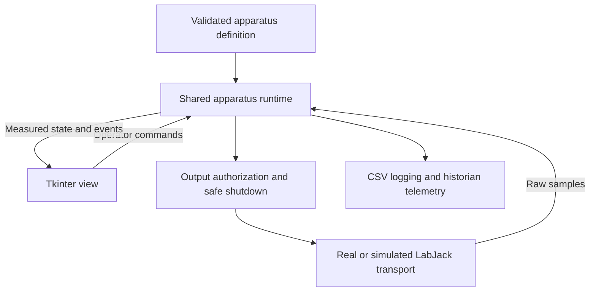

# LabJack codebase review and expansion plan

Review date: October 8, 2026.

## Main recommendation

Build one shared apparatus runtime, then add the ten new systems as validated
definitions plus small custom views. Keep Tkinter during this expansion. The
existing hardware wrapper, configuration registry, reusable widgets, and recent
logger/input fixes are useful foundations, but connection, shutdown, output
handling, and mode changes are still duplicated across the views.

Assumption: the ten systems will be selectable apparatus, with one active control
screen per application instance. The current single-session model can support
that arrangement. Concurrent control from one application would require a
separate runtime and hardware handle for each apparatus. Multiple controlling
stations additionally require ownership enforcement across those stations.

## Scope and verification

Reviewed the active launcher, all shared core modules, three apparatus views,
seven apparatus configurations and their registry, setup/run scripts, tests,
existing design documents, and the separate Historian service. Historical and
development trees were inventoried and checked for entry points, duplicated
controllers, logging, and direct hardware access; they were not recommissioned or
reviewed line by line as production applications. The legacy GUI under
`assets/PackedColumnGui.py` also remains outside the active launcher.

The active launcher/core/views/configurations contain about 5,850 lines of Python.
The three custom views alone contain 2,111 lines. Six apparatus units are
registered; Pump Cart is a separate unfinished configuration. The historical
trees contain 105 Python files in Archive and 18 in Development, including theme
utilities, making an explicit production/reference boundary useful.

Diagnostics used fake hardware and headless objects. They did not open LabJack
connections. They reproduced missing shutdown writes, acceptance of invalid
output commands, held output after sensor failure, calibration masking of NaN,
enablement after connection setup failure, and the theme-switch naming collision.
The existing regression suite was also rerun; see the final verification note.

## Fix before bringing additional systems into production

### 1. Make the shared shutdown path complete

`SafetyManager.safe_outputs` starts empty. `register_safe_output()` has no callers
in the active application. Consequently, the shared shutdown routine can print
that it is executing safe-zero and then close the device without writing any
configured outputs. Individual views partly compensate with their own writes,
but their sequences differ.

Packed Columns closes its DAQ at `apps/packed_columns.py:652` before invoking
`_disable_powered_controls()` at line 659. The subsequent output resets cannot
reach the closed connection. Other paths can stop their shutdown sequence after
one write raises an exception. `main.py:349` suppresses disconnect exceptions.

Declare every controlled output, including custom heater, gas-flow, selector,
power, and TDAC channels. One idempotent shutdown operation should block further
control commands, attempt every configured safe output while the handle is open,
record per-channel success/failure, cancel scheduling, finish logging, and close
the connection. Safe values must reflect each apparatus's wiring and actuator
behavior; they should not be inferred from which widgets happen to be visible.

Acceptance: tests cover Disable, Disconnect, Back, Close, connection setup
failure, write failure, and repeated shutdown. Every declared output receives its
safe command before close; one failed channel does not prevent attempts on others.

Evidence: `core/safety.py:20`, `core/safety.py:36`,
`core/base_app.py:531`, `apps/packed_columns.py:648`, `main.py:347`.

### 2. Validate raw readings and define control fault behavior

The update loop marks a failed process reading as `Error`, but AUTO then skips
writing a new output. A diagnostic left the prior 1.00833 V command unchanged
after a simulated sensor failure. Missing gate names also bypass gating because
the condition checks whether the gate exists before enforcing it.

Checking only the calibrated value is insufficient. Current calibrations using
`min()` and `max()` can hide a NaN raw reading. Diagnostics produced:

| NaN input to existing calibration | Result |
| --- | --- |
| Catalytic #1 pressure | 0.0 psia |
| Exchanger #1 level | 1.96 ft, its configured maximum |
| Exchanger #1 steam pressure | 150.0 psig, its configured maximum |

Validate raw values before calibration, then validate calibrated values and
plausibility. Store measurement quality and age separately from the number.
Define the approved behavior for invalid/stale control inputs and enforce it in
the runtime, including an appropriate safe command and fault indication. Keep
logging functioning so the fault and surviving channels remain observable.

The catalytic gas-flow check runs when the heater is switched on; it is not a
continuous loss-of-flow interlock. Move required operating interlocks into checks
performed throughout control operation, with apparatus-approved thresholds.

Evidence: `core/base_app.py:703`, `core/base_app.py:723`,
`core/base_app.py:733`, `configs/catalytic_methanation_1.py:172`,
`configs/shell_tube_hx_1.py:89`, `apps/catalytic_methanation.py:586`.

### 3. Separate successful connection from permission to run

`BaseAppFrame._connect()` catches setup errors without returning an explicit
success result or closing a partially opened connection. The catalytic override
then tests only `daq.is_connected` and enters ENABLED. A fake channel-setup error
reproduced both the displayed connection error and an ENABLED state.

Use explicit results and validated state transitions. Connect should finish
channel setup and initial safe-output commands before reporting success. A failed
setup must leave the apparatus disabled and clean up its handle. Enable should
be an explicit operation after required checks. Reset control state on Disable
and define reconnect behavior so previous AUTO/manual commands cannot silently
resume. Match the UI to the authoritative runtime state.

Bind configurations to device serial numbers and verify the connected identity.
The current USB path uses `ANY`, which does not establish apparatus identity.
LJM supports identifying devices by serial number and supports multiple device
connections; connection existence therefore does not establish control ownership.
[LabJack opening/closing documentation](https://support.labjack.com/docs/opening-and-closing-ljm-user-s-guide).

Evidence: `core/base_app.py:571`, `apps/catalytic_methanation.py:515`,
`core/labjack_interface.py:34`, `core/safety.py:26`.

### 4. Enforce numeric limits at the command boundary

Numeric-entry validation now rejects malformed text, but finite numbers can still
exceed physical/configured limits. Spinbox arrow limits do not validate manually
typed values. The transport accepts arbitrary register/value pairs when ENABLED;
a fake transport accepted both 9 V and NaN for DAC0 without application checks.

The packed-column air UI uses 0–1000 SLPM while its configuration says 0–150.
Catalytic gas application checks totals and ratios but does not enforce each
configured minimum/maximum; negative totals bypass the positive-total checks.
PID factory output limits also default to a universal 0–5 V rather than reading
per-actuator definitions.

Validate allowed channels, finite values, engineering limits, scaling, physical
limits, and operating interlocks in the shared command service. Distinguish
rejecting an invalid operator request from intentional controller saturation.
Preserve the original requested value and resulting applied command in events.

Evidence: `core/labjack_interface.py:101`, `core/base_app.py:758`,
`apps/packed_columns.py:507`, `configs/packed_columns.py:64`,
`apps/catalytic_methanation.py:624`, `core/base_app.py:93`.

## Foundation for adding ten systems

### 5. Separate the runtime from the screen

`BaseAppFrame` currently combines view construction, polling, control, hardware
setup, lifecycle, logging, and navigation. Sensor and ControlLoop objects hold
Tkinter variables, and PID calculations read measurements rounded for display.
Configuration modules import their view classes and maintain mutable cold-junction
state. The Historian separately duplicates channel maps and calibrations.

Move numeric state and control into ordinary Python objects. The view should send
commands and render snapshots. Keep full measurement precision for calculations
and logs; round only the display. Use one versioned calibration definition per
channel, with units, valid range, calibration date/source, and tests. Unit-specific
differences should be explicit overrides of a shared family definition.

The logger should subscribe to runtime snapshots. The Historian can consume those
snapshots where a controller is present; independently polled idle apparatus
should reuse the same read-only channel/calibration definitions.

Keep separate extension points for calibration, preflight/continuous interlocks,
and custom diagram presentation. A new system should not need its own connection,
disconnect, polling, CSV writer, or mode-switch implementation.

### 6. Make system definitions validated and independently testable

Use a typed definition containing apparatus ID, family, unit, device identity,
input channels, output channels and safe values, loop definitions, interlocks,
log schema, and view metadata. Keep runtime state outside that definition.

Validate definitions before touching hardware: required pins, known references,
calibration parameters, numeric limits/defaults, legal tuning, scaling, required
interlocks, and unique apparatus IDs. Declare optional/unassigned sensors explicitly.
Pump Cart's placeholder pins must prevent production enablement.

Shared outputs need explicit arbitration. Packed Columns intentionally assigns
two mutually exclusive level loops to DAC0; a validator should accept declared
exclusive ownership, while rejecting accidental collisions or contradictory gates.

Add a creation template containing a definition, optional view, simulated profile,
reference calibration tests, commissioning record, and catalog entry. Define
development/simulation/commissioned status in the catalog. Tests should discover
registered systems automatically; their current hardcoded CONFIGS list will not
automatically include a new system.

Evidence: `configs/__init__.py`, `configs/pump_cart.py:160`,
`configs/packed_columns.py:140`, `tests/test_app_ui.py:20`.

### 7. Give polling and scheduling one owner

Three recurring Tk callbacks perform hardware reads, control, and manual output
writes. Network delays can block the interface. Sensor and loop channels can be
read separately even when they refer to the same physical measurement. Callback
IDs are not retained for cancellation; the test harness explicitly cleans up
legacy scheduling beyond what production destruction does.

Use one serialized I/O/control worker per active session, with bounded timeouts,
monotonic elapsed time, cycle health reporting, and explicit stop/join behavior.
Keep every Tk interaction on the main thread. Batch channel reads when practical;
LabJack's [eReadNames](https://support.labjack.com/docs/ereadnames-ljm-user-s-guide)
reads multiple named registers in one command. Batching improves efficiency but
does not by itself make all physical samples simultaneous.

Provide a separate simulated transport with deterministic readings, configurable
noise, and fault injection. Production reads must distinguish disconnected from
valid zero: `LabJackInterface.read()` currently returns 0.0 when reads are blocked.
The current random fallback does not model actuator/process response.

Evidence: `core/base_app.py:678`, `core/base_app.py:782`,
`core/labjack_interface.py:81`, `tests/test_app_ui.py:76`.

### 8. Add tests for the shared runtime and each system definition

Retain the recent input/logger/UI regressions and add headless tests for state
transitions, safe-output coverage, failed connection setup, failed reads/writes,
raw NaN, stale measurements, output bounds, shared-output arbitration, lost
interlocks, reconnect, and shutdown with pending work. Test calibration reference
points and bounds, not just whether a GUI can be constructed.

Use the same transport contract in tests and production so fake hardware exercises
the actual lifecycle/output gate. Keep a smaller set of UI tests for bindings,
mode locks, messages, navigation, and theme behavior. Automate definition checks
and runtime tests on every change, with a desktop UI test run before releases.

Document separate physical commissioning checks for every apparatus: identity,
channel wiring, polarity, calibration references, actuator limits/safe values,
fault behavior, interlocks, and a representative logged experiment. Software test
success is not a substitute for these measurements.

## Operations and maintenance improvements

### Logging and Historian

The recent CSV fixes isolate bad sources and remove worker-thread Tk access.
Extend them with full date/time including timezone and subsecond precision,
apparatus ID, application/configuration/calibration versions, session ID, and
simulation/real mode. Record quality and sample age alongside values. Standardize
log fields across systems; packed-column logs currently omit both level readings.

Use configurable absolute storage locations, file rotation/retention, a bounded
writer queue, and a visible backlog/file-error indication. Define what happens
when shutdown's one-second writer join expires. Preserve diagnostic events when
control faults; telemetry failure and control-input failure have different effects.

The Historian has its own maps/calibrations, a source-embedded token, and an ESP32
POST endpoint without an authentication check. Move credentials outside source;
rotate them if they have been exposed. Validate incoming fields, finite values,
units, device identity, and allowed apparatus IDs. Improve its per-channel error
isolation: one bad sensor currently abandons the whole point and enters the
connection-retry path. An initial connection failure can end that apparatus thread;
add supervised retry/backoff and per-apparatus health reporting. Close worker
handles and join workers before closing the InfluxDB client on service shutdown.

### Device-side recovery and control ownership

Evaluate configured startup states and the T7 watchdog alongside the application
fault path. PC/network failure can prevent software shutdown commands. The
[LabJack watchdog](https://support.labjack.com/docs/23-0-watchdog-t-series-datasheet)
can apply configured DIO/DAC actions and supports strict clearing. A controller-
owned strict heartbeat is relevant here: ordinary Historian reads must not conceal
a stalled control application. Verify TDAC/accessory shutdown through the actual
power/relay architecture; do not assume built-in DAC watchdog settings cover it.
Choose timeout and safe-action settings during apparatus commissioning.

If more than one station can command the same apparatus, implement an exclusive
owner/lease checked by the common output gate. A local process lock only protects
one station. The existing proposed safety/lifecycle plan covers distributed
ownership and room authorization, but those facilities are not implemented.

### Deployment, catalog, and small correctness fixes

Make launchers work independently of the working directory, resolve packaged
images/themes explicitly, and place logs in a chosen data folder. Pin a tested
Python/dependency/native-driver combination and ship tagged releases with rollback
instructions. Separate Historian dependencies from desktop dependencies.

Archive and Development are ignored and the Historian is currently untracked.
Preserve historical sources in recoverable Git snapshots and make deployed service
code versioned. Remove the 24 tracked bytecode/OS-generated files from future
source commits after reviewing the repository state; `.gitignore` alone does not
untrack existing files.

The dashboard has a fixed three-column card grid without scrolling. Add scrolling,
search, family/room filters, and commissioned/development status before the catalog
grows to thirteen families. Move common control panels, styles, image loading,
and normalized diagram-overlay coordinates into reusable presentation components.

Rename the configuration attribute from `self.config` to `self.system_definition`
or `self.system_config`. It currently shadows Tkinter's `config()` method; both
exchanger and packed-column theme callbacks call it and raise TypeError. Also
replace the shared hardcoded override password with an explicit staff-access
policy and record override events. Protected operating limits should be handled
in the runtime rather than by view-specific password dialogs.

## Suggested rollout sequence

| Stage | Deliverable | Completion criterion |
| --- | --- | --- |
| Foundation | Shared safe shutdown, fault behavior, command limits, validated definitions, identity checks | Fault diagnostics become passing regression tests; every output is declared |
| Pilot | Move one exchanger onto the runtime, then catalytic methanation | Current screens work and physical commissioning passes; complex interlocks use shared services |
| Template | Creation template, automatic catalog-based tests, commissioning record, deployment package | A new system can be added without modifying shared control/lifecycle code |
| Expansion | Add the ten systems in small batches | Each batch passes software tests and apparatus commissioning before production registration |
| Follow-up | Historian consolidation, catalog usability, broader telemetry and access controls | Ownership, storage, and health behavior match the deployed lab arrangement |

The existing `docs/safety-lifecycle-and-migration-plan.md` already describes much
of the desired safety model. Use it as the specification and track concrete
implementation gaps rather than starting a competing design. The earlier
`docs/pid-review.md` remains applicable: reverse-gain anti-windup, manual/AUTO
tracking, and elapsed-time handling are higher priorities than a velocity-form
rewrite. This review made no control-algorithm or production-source changes.

## Final verification

The full existing suite passed: 17 tests, with real Tk widgets and fake I/O.
The headless run also passed its 9 enabled tests (8 UI tests skipped).
These tests cover the recent feature updates; the additional fault reproductions
above expose behavior that the current suite does not yet check.
